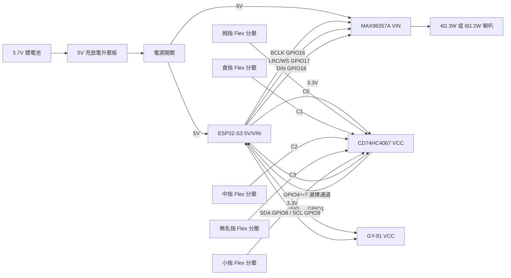

# 單手手語翻譯手套：硬體接線圖

本圖對應目前 `micropython/common/config.py` 的 GPIO。先在桌面完成測試，再裝到手套上。

> **接電前必看：**ESP32-S3、GY-91、CD74HC4067 的訊號都使用 **3.3V**。所有模組的 `GND` 必須相連。裸 Flex Sensor 必須搭配分壓電阻，不能直接接 ESP32。

## 1. 系統總圖



## 2. ESP32-S3 接線總表

| ESP32-S3 腳位 | 接到哪裡 | 功能 |
|---|---|---|
| `5V` 或 `VIN` | 電源開關輸出的穩定 5V | ESP32 供電 |
| `3V3` | CD74HC4067 `VCC`、GY-91 `VCC` | 3.3V 感測器供電 |
| `GND` | 全部模組 GND | 共地 |
| `GPIO1` | CD74HC4067 `SIG`／`COM` | 讀取 Flex 類比電壓 |
| `GPIO4` | CD74HC4067 `S0` | MUX 位址選擇 |
| `GPIO5` | CD74HC4067 `S1` | MUX 位址選擇 |
| `GPIO6` | CD74HC4067 `S2` | MUX 位址選擇 |
| `GPIO7` | CD74HC4067 `S3` | MUX 位址選擇 |
| `GPIO8` | GY-91 `SDA` | I2C 資料 |
| `GPIO9` | GY-91 `SCL` | I2C 時脈 |
| `GPIO16` | MAX98357A `BCLK` | I2S 位元時脈 |
| `GPIO17` | MAX98357A `LRC`／`WS` | I2S 左右聲道時脈 |
| `GPIO18` | MAX98357A `DIN` | I2S 音訊資料 |

不同 ESP32-S3 開發板的絲印可能寫成 `1`、`IO1` 或 `GPIO1`，三者意思相同。**不要照開發板排針的物理順序猜腳位，只看板上的文字。**

## 3. 五支 Flex Sensor 分壓電路

每根手指都要做一組完全相同的電路：

```text
ESP32 3V3
    │
    └── Flex Sensor ──●──── CD74HC4067 的 C0～C4
                      │
                      ├──── 10kΩ 1% 電阻 ─── GND
                      │
                      └──── 0.1uF 電容 ───── GND
```

`●` 是分壓輸出點。固定電阻與 0.1uF 電容都接在輸出點和 GND 之間。

| 手指 | CD74HC4067 通道 |
|---|---|
| 拇指 | `C0` |
| 食指 | `C1` |
| 中指 | `C2` |
| 無名指 | `C3` |
| 小指 | `C4` |

Flex Sensor 沒有正負極，但五支的安裝方向與線路接法要一致。其餘 `C5～C15` 不接。

### 如果你使用的是 Flex Sensor 轉換小板

你之前圖片中的轉換板有 `AO`、`DO`、`GND`、`VCC`：

- `VCC` 接 3.3V。
- `GND` 接 GND。
- `AO` 接 CD74HC4067 的 `C0～C4`。
- `DO` 不接。

轉換板已含部分分壓與比較電路時，不要再重複串接 10kΩ 分壓。**裸 Flex Sensor 用上面的 10kΩ 電路；轉換板則使用它的 AO，兩種方式二選一。** 五根手指需要五路轉換電路。

## 4. CD74HC4067 接線

| CD74HC4067 | 接到 |
|---|---|
| `VCC` | ESP32 `3V3` |
| `GND` | ESP32 `GND` |
| `EN` | GND，保持啟用 |
| `S0` | ESP32 `GPIO4` |
| `S1` | ESP32 `GPIO5` |
| `S2` | ESP32 `GPIO6` |
| `S3` | ESP32 `GPIO7` |
| `SIG`／`COM` | ESP32 `GPIO1` |
| `C0～C4` | 五根 Flex 的分壓輸出／轉換板 AO |

CD74HC4067 必須以 3.3V 供電，這樣輸出不會超過 ESP32 ADC 可承受範圍。

## 5. GY-91／MPU9250 接線

| GY-91 | 接到 ESP32-S3 |
|---|---|
| `VCC` | `3V3` |
| `GND` | `GND` |
| `SDA` | `GPIO8` |
| `SCL` | `GPIO9` |
| `INT` | 不接 |
| `FSYNC`、其他腳位 | 不接 |

GY-91 裝在手背，方向固定，不要讓它在手套上晃動。與喇叭磁鐵盡量保持距離，否則磁力計容易受干擾。

## 6. MAX98357A 與喇叭接線

| MAX98357A | 接到 |
|---|---|
| `VIN` | 電源開關後的穩定 `5V` |
| `GND` | 共地 |
| `BCLK` | ESP32 `GPIO16` |
| `LRC`／`WS` | ESP32 `GPIO17` |
| `DIN` | ESP32 `GPIO18` |
| `GAIN` | 先不接，使用模組預設增益 |
| `SD`／`MODE` | 先不接，使用模組預設設定 |
| `SPK+` | 喇叭正端 |
| `SPK-` | 喇叭負端 |

喇叭必須接在 `SPK+` 與 `SPK-` 之間，**喇叭任何一端都不要接 GND**，因為 MAX98357A 是橋接輸出。

將 `470uF / 10V` 電解電容並聯在 MAX98357A 附近：

```text
5V  ───── 電容正極（長腳／標示 +）
GND ───── 電容負極（外殼有白色負極條紋）
```

電解電容接反可能發熱或損壞，通電前再次確認。

## 7. 電池、升壓板與開關

```text
3.7V 鋰電池
   │ B+ / B-
   ▼
5V 充放電升壓板
   │ 穩定 5V 輸出
   ▼
電源開關
   ├── ESP32-S3 的 5V/VIN
   └── MAX98357A 的 VIN

所有 GND 直接共地
```

你的充放電板型號可能從 Type-C 輸出 5V，也可能有 `OUT+ / OUT-` 焊盤。接 ESP32 前必須用萬用表確認輸出約為 5.0V：

1. 黑表筆接輸出負極。
2. 紅表筆接輸出正極。
3. 讀值應約為 5V。
4. 若量到約 3.0～4.2V，那是電池端，不是升壓後的 5V 輸出。

寫程式或使用 USB 時，先關閉外部電池電源，避免 USB 5V 與升壓板 5V 互相回灌。確認開發板有電源隔離設計後，才考慮同時供電。

## 8. 建議接線順序

不要一次全部接完。按照以下順序，每完成一步才進到下一步：

1. 只用 USB 啟動 ESP32-S3。
2. 接 GY-91，先確認 I2C 能找到 `0x68` 與磁力計 `0x0C`。
3. 接 CD74HC4067，但先只接一根 Flex 到 `C0`。
4. 確認一根 Flex 數值會隨彎曲改變，再接其餘四根。
5. 接 MAX98357A，不接喇叭前先重新檢查 5V 與 GND。
6. 接喇叭並用低音量 WAV 測試。
7. 最後才接鋰電池、升壓板、開關和 470uF 電容。
8. 全部桌面測試成功後，再把線固定到手套。

## 9. 通電前檢查表

- [ ] ESP32 的 `3V3` 沒有和 `5V` 短接。
- [ ] CD74HC4067 與 GY-91 接的是 3.3V。
- [ ] 所有 GND 已共地。
- [ ] 五個 Flex 輸出最高不超過 3.3V。
- [ ] MAX98357A 使用 5V，I2S 訊號來自 GPIO16、17、18。
- [ ] 喇叭只接 SPK+ 與 SPK-，沒有接 GND。
- [ ] 470uF 電解電容正負極正確。
- [ ] 升壓板輸出已用萬用表確認約 5V。
- [ ] 裸露焊點沒有碰到相鄰腳位。
- [ ] 第一次上電時，手放在電源開關旁，若發熱或有異味立即斷電。

## 10. 目前接線與程式的對照

若實際板子沒有上述 GPIO，請先修改 `micropython/common/config.py`，重新執行 `03_建立左右手檔案.cmd`，再上傳單手程式。不要只改接線而不改程式。
