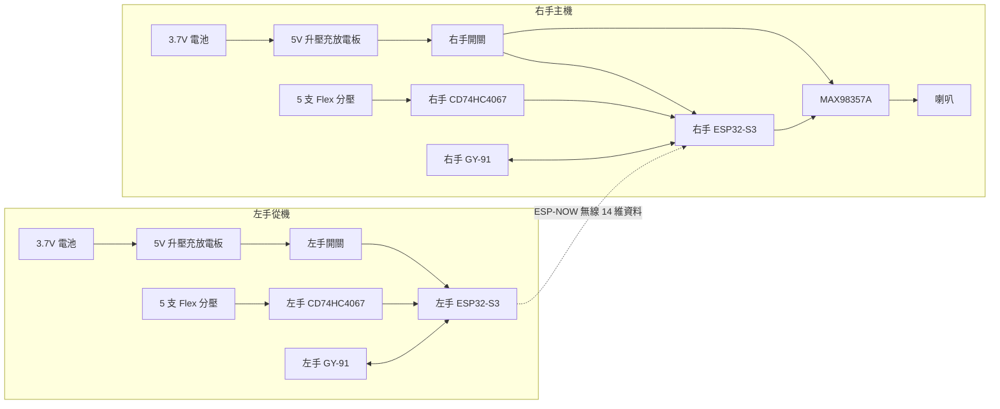

# 雙手手語翻譯手套：完整硬體接線圖

雙手模式由兩套獨立手套組成：

- **左手從機：**讀取左手 5 支 Flex 與 GY-91，透過 ESP-NOW 無線傳送資料。
- **右手主機：**讀取右手感測器、接收左手資料、辨識動作，並控制喇叭發聲。

兩隻手之間**不接訊號線或電源線**。兩邊各自使用電池供電，只透過 ESP-NOW 無線通訊。

> ESP32-S3、GY-91、CD74HC4067 的訊號電壓為 3.3V。每隻手內部都必須共地，但左右手不需要用導線互接 GND。

## 1. 雙手系統總圖



## 2. 左手從機完整接線

### 左手 ESP32-S3 對照表

| 左手 ESP32-S3 | 接到左手零件 | 用途 |
|---|---|---|
| `5V`／`VIN` | 左手電源開關輸出的 5V | 開發板供電 |
| `3V3` | 左手 CD74HC4067 `VCC`、左手 GY-91 `VCC` | 感測器供電 |
| `GND` | 左手所有 GND | 左手共地 |
| `GPIO1` | 左手 CD74HC4067 `SIG`／`COM` | Flex 類比輸入 |
| `GPIO4` | 左手 CD74HC4067 `S0` | MUX 選擇 |
| `GPIO5` | 左手 CD74HC4067 `S1` | MUX 選擇 |
| `GPIO6` | 左手 CD74HC4067 `S2` | MUX 選擇 |
| `GPIO7` | 左手 CD74HC4067 `S3` | MUX 選擇 |
| `GPIO8` | 左手 GY-91 `SDA` | I2C 資料 |
| `GPIO9` | 左手 GY-91 `SCL` | I2C 時脈 |

左手的 `GPIO16`、`GPIO17`、`GPIO18` 不使用，因為左手沒有功放和喇叭。

### 左手五指通道

| 左手手指 | 左手 CD74HC4067 |
|---|---|
| 拇指 | `C0` |
| 食指 | `C1` |
| 中指 | `C2` |
| 無名指 | `C3` |
| 小指 | `C4` |

### 左手 CD74HC4067

| 左手 CD74HC4067 | 接到 |
|---|---|
| `VCC` | 左手 ESP32 `3V3` |
| `GND` | 左手 GND |
| `EN` | 左手 GND |
| `S0` | 左手 `GPIO4` |
| `S1` | 左手 `GPIO5` |
| `S2` | 左手 `GPIO6` |
| `S3` | 左手 `GPIO7` |
| `SIG`／`COM` | 左手 `GPIO1` |
| `C0～C4` | 左手五根 Flex 分壓輸出 |

### 左手 GY-91

| 左手 GY-91 | 接到左手 ESP32 |
|---|---|
| `VCC` | `3V3` |
| `GND` | `GND` |
| `SDA` | `GPIO8` |
| `SCL` | `GPIO9` |
| `INT`、`FSYNC` 等 | 不接 |

### 左手電源

```text
左手 3.7V 鋰電池
        │ B+ / B-
        ▼
左手 5V 充放電升壓板
        │ 穩定 5V
        ▼
左手電源開關
        │
        └── 左手 ESP32-S3 5V/VIN
```

左手沒有喇叭，耗電通常低於右手。升壓板輸出接 ESP32 前，先用萬用表確認約為 5V。

## 3. 右手主機完整接線

### 右手 ESP32-S3 對照表

| 右手 ESP32-S3 | 接到右手零件 | 用途 |
|---|---|---|
| `5V`／`VIN` | 右手電源開關輸出的 5V | 開發板供電 |
| `3V3` | 右手 CD74HC4067 `VCC`、右手 GY-91 `VCC` | 感測器供電 |
| `GND` | 右手所有 GND | 右手共地 |
| `GPIO1` | 右手 CD74HC4067 `SIG`／`COM` | Flex 類比輸入 |
| `GPIO4` | 右手 CD74HC4067 `S0` | MUX 選擇 |
| `GPIO5` | 右手 CD74HC4067 `S1` | MUX 選擇 |
| `GPIO6` | 右手 CD74HC4067 `S2` | MUX 選擇 |
| `GPIO7` | 右手 CD74HC4067 `S3` | MUX 選擇 |
| `GPIO8` | 右手 GY-91 `SDA` | I2C 資料 |
| `GPIO9` | 右手 GY-91 `SCL` | I2C 時脈 |
| `GPIO16` | MAX98357A `BCLK` | I2S 時脈 |
| `GPIO17` | MAX98357A `LRC`／`WS` | I2S 聲道時脈 |
| `GPIO18` | MAX98357A `DIN` | I2S 音訊資料 |

### 右手五指通道

| 右手手指 | 右手 CD74HC4067 |
|---|---|
| 拇指 | `C0` |
| 食指 | `C1` |
| 中指 | `C2` |
| 無名指 | `C3` |
| 小指 | `C4` |

### 右手 CD74HC4067

| 右手 CD74HC4067 | 接到 |
|---|---|
| `VCC` | 右手 ESP32 `3V3` |
| `GND` | 右手 GND |
| `EN` | 右手 GND |
| `S0` | 右手 `GPIO4` |
| `S1` | 右手 `GPIO5` |
| `S2` | 右手 `GPIO6` |
| `S3` | 右手 `GPIO7` |
| `SIG`／`COM` | 右手 `GPIO1` |
| `C0～C4` | 右手五根 Flex 分壓輸出 |

### 右手 GY-91

| 右手 GY-91 | 接到右手 ESP32 |
|---|---|
| `VCC` | `3V3` |
| `GND` | `GND` |
| `SDA` | `GPIO8` |
| `SCL` | `GPIO9` |
| `INT`、`FSYNC` 等 | 不接 |

### 右手 MAX98357A 與喇叭

| MAX98357A | 接到 |
|---|---|
| `VIN` | 右手電源開關後的 5V |
| `GND` | 右手 GND |
| `BCLK` | 右手 `GPIO16` |
| `LRC`／`WS` | 右手 `GPIO17` |
| `DIN` | 右手 `GPIO18` |
| `GAIN`、`SD`／`MODE` | 先不接，使用模組預設 |
| `SPK+` | 喇叭正端 |
| `SPK-` | 喇叭負端 |

喇叭只接 `SPK+` 和 `SPK-`，任何一端都不能接 GND。

在 MAX98357A 附近並聯 470uF／10V 電解電容：電容正極接 5V，負極接 GND。

### 右手電源

```text
右手 3.7V 鋰電池
        │ B+ / B-
        ▼
右手 5V 充放電升壓板
        │ 穩定 5V
        ▼
右手電源開關
        ├── 右手 ESP32-S3 5V/VIN
        └── MAX98357A VIN
```

右手喇叭播放時電流較大，5V 輸出必須穩定。若播放時 ESP32 重開機，優先檢查升壓板輸出能力、電池電量、線徑與 470uF 電容。

## 4. 十支 Flex Sensor 的相同分壓接法

左右手每一根裸 Flex Sensor 都要各自配一顆固定電阻與一顆濾波電容，因此雙手總共需要 10 組：

```text
該手 ESP32 的 3V3
        │
        └── Flex Sensor ──●──── 該手 CD74HC4067 的 C0～C4
                          │
                          ├──── 10kΩ 1% 電阻 ─── 該手 GND
                          │
                          └──── 0.1uF 電容 ───── 該手 GND
```

若使用有 `AO` 的 Flex 轉換板，`AO` 直接接該手的 `C0～C4`，不要再重複做一組 10kΩ 分壓。`DO` 不使用。

## 5. ESP-NOW 無線連線

ESP-NOW 是兩塊 ESP32-S3 之間的無線通訊，不需要增加接線：

```text
左手 ESP32  -- 2.4GHz ESP-NOW -->  右手 ESP32
   14 維資料                         合併成 28 維
```

需要在 `micropython/common/config.py` 填入兩塊板子的真實 MAC：

```python
LEFT_HAND_MAC = "左手實際 MAC"
RIGHT_HAND_MAC = "右手實際 MAC"
```

單手模式不需要填 MAC；切換雙手模式時才需要。

## 6. 雙手實際組裝位置

| 零件 | 建議位置 |
|---|---|
| Flex Sensor | 每根手指背面，避免超過允許彎曲半徑 |
| GY-91 | 手背中央，固定方向且不可晃動 |
| CD74HC4067 | 手背或手腕，靠近 ESP32 |
| ESP32-S3 | 手腕外側，USB 孔需能插線 |
| 電池與升壓板 | 手腕處，避免放在手指上 |
| MAX98357A | 右手手腕，靠近喇叭與 470uF 電容 |
| 喇叭 | 右手手腕外側，遠離 GY-91 磁力計 |
| 電源開關 | 手腕容易操作的位置 |

Flex Sensor 金屬腳非常脆弱，焊接後使用熱縮套管與軟膠固定。手指活動部分使用 28～30AWG 多股軟線，並預留彎曲長度。

## 7. 雙手接線與測試順序

1. 先完成右手，使用單手程式測試五支 Flex、GY-91、功放與喇叭。
2. 右手完全正常後，再組左手。
3. 左手先只測 GY-91，再逐支增加 Flex。
4. 分別取得兩塊 ESP32-S3 的 MAC。
5. 將 MAC 填入 `config.py` 並重建部署檔。
6. 使用 `05_上傳左手程式.cmd` 上傳左手。
7. 使用 `06_上傳右手程式.cmd` 上傳右手。
8. 先用 USB 觀察 ESP-NOW 是否顯示左手在線。
9. 通訊正常後，重新錄製雙手 28 維動作。
10. 最後才改用兩邊電池獨立供電測試。

## 8. 雙手通電前檢查表

- [ ] 左手與右手各有自己的電池、升壓板與開關。
- [ ] 左右手之間沒有接任何實體線。
- [ ] 兩邊 CD74HC4067 與 GY-91 都使用 3.3V。
- [ ] 每隻手內部所有 GND 已共地。
- [ ] 十根 Flex 各有分壓電路，輸出不超過 3.3V。
- [ ] 左手沒有接 MAX98357A。
- [ ] 右手 MAX98357A 使用穩定 5V。
- [ ] 右手喇叭只接 SPK+ 與 SPK-。
- [ ] 右手 470uF 電容正負極正確。
- [ ] 兩邊升壓輸出都已用萬用表確認約為 5V。
- [ ] GY-91 已固定，右手 GY-91 遠離喇叭磁鐵。
- [ ] 使用 USB 燒錄時先關閉該手的外部電池電源。

## 9. 與單手圖的關係

現階段先照 `硬體接線圖_單手版.md` 完成右手。右手接法可直接保留到雙手模式；之後只需按照本文件新增左手，並設定 ESP-NOW MAC，不必拆掉右手重接。
